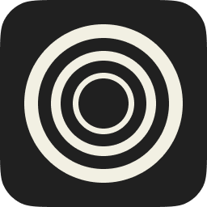

<!--
   - This Source Code Form is subject to the terms of the Mozilla Public
   - License, v. 2.0. If a copy of the MPL was not distributed with this
   - file, You can obtain one at http://mozilla.org/MPL/2.0/.
   -->



# Super Zen

**[Zen Browser](https://github.com/zen-browser/desktop), plus Arc's best trick: Little Arc.**
For everyone moving off Arc now that it's being sunset.

[**Download for macOS (Apple Silicon)**](https://github.com/LycoKodo/super-zen/releases/latest) · [Zen docs](https://docs.zen-browser.app) · [Upstream Zen](https://github.com/zen-browser/desktop)

<br clear="left">

Super Zen is Zen 1.23.4b (Firefox 159) with three additions:

- **Little windows**: Arc's Little Arc. Press <kbd>⌘</kbd><kbd>⌥</kbd><kbd>N</kbd> in any app and a small browser window slides down over it, even over a fullscreen app. Look something up, then close it and you're back where you were, or send the page to a space.
- **Arc import**: brings over every Arc profile with its history, passwords, payment cards, cookies (so you stay signed in), spaces, pinned tabs and favorites.
- **Normal Zen sync**: sign in with your Mozilla account, exactly as in Zen.

Everything else is Zen, unchanged.

## Install

1. Download `Super-Zen-…-macOS-arm64.dmg` from the [latest release](https://github.com/LycoKodo/super-zen/releases/latest).
2. Open it and drag **Super Zen** into **Applications**.
3. Open Super Zen. The app isn't notarized by Apple (that needs a paid developer account), so macOS blocks it the first time. To allow it:
   - open **System Settings › Privacy & Security**, scroll down and click **Open Anyway** next to "Super Zen", or
   - run this once in Terminal:

     ```sh
     xattr -dr com.apple.quarantine "/Applications/Super Zen.app"
     ```

Super Zen is a separate app with its own profile, so it runs side by side with Zen, Firefox or Arc.

**Updates**: Super Zen doesn't update itself, and won't turn into regular Zen. Download new versions from [Releases](https://github.com/LycoKodo/super-zen/releases).

## Little windows

| | |
| --- | --- |
| Open one | <kbd>⌘</kbd><kbd>⌥</kbd><kbd>N</kbd> from any app while Super Zen is running, or **File › New Little Window** |
| Go somewhere | The address bar is already open: type a URL or a search |
| Pick its space | The space button in the toolbar shows where the page will go. Click it to choose another |
| Keep the page | **Open in _Space_** or <kbd>⌘</kbd><kbd>O</kbd> moves it into that space in your main window |
| Close it | <kbd>⌘</kbd><kbd>W</kbd>. It slides back up and you're returned to the app you were in |

- **Works everywhere.** It opens on whatever desktop or fullscreen app you're in, without switching Spaces or bringing your main window forward.
- **Feels instant.** One little window is kept ready, hidden. It shows up in about 70 ms and slides down from under the menu bar like a Hyprland dropdown terminal, with a small bounce.
- **Remembers itself.** Move or resize one, and the next opens in the same place and size.
- **Links from other apps** (Mail, Slack, …) open in a little window too, like in Arc.
- **Cyber theme**: sky blue and white with cyan glows, after Blue Archive. Switch to `space` to use your space's own colors, like Little Arc.

### Settings

Change the shortcut in **Settings › Keyboard Shortcuts › New Little Window**. It works from other apps when it includes <kbd>⌘</kbd> or <kbd>Ctrl</kbd>.

The rest live in `about:config`:

| Preference | Default | |
| --- | --- | --- |
| `zen.little-window.enabled` | `true` | Little windows at all |
| `zen.little-window.global-shortcut` | `true` | The shortcut works from any app (macOS) |
| `zen.little-window.open-external-links` | `true` | Links from other apps open in a little window |
| `zen.little-window.theme` | `cyber` | `cyber`, or `space` for the space's colors |
| `zen.little-window.preload` | `true` | Keep one ready so it opens at once. Turn off to save a little memory |

## Import from Arc

1. Quit Arc and Super Zen.
2. Clone this repository, then run:

   ```sh
   python3 tools/arc-import/import_arc.py --app "/Applications/Super Zen.app"
   ```

3. When macOS asks about **Arc Safe Storage**, click **Always Allow**. It's needed to decrypt Arc's passwords and cookies.

Super Zen opens, imports, and quits when done. Each Arc profile becomes its own container. Extensions aren't imported, so install their Firefox versions from [addons.mozilla.org](https://addons.mozilla.org). Options: `--profile <dir>` for another Super Zen profile, `--no-spaces` to skip Arc's sidebar.

## Sync

Super Zen uses Firefox Sync, like Zen. Sign in with your Mozilla account in **Settings › Sync**. Bookmarks, history, passwords and open tabs then sync with Zen, Firefox and your other devices.

## Known limitations

- **macOS on Apple Silicon only** for the prebuilt app. Little windows opening from other apps is macOS only.
- **No DRM video.** Netflix, Disney+, Spotify's web player and some course video players won't play. Widevine only runs in browsers Google has signed, which a personal build can't be.
- **Arc takes <kbd>⌘</kbd><kbd>⌥</kbd><kbd>N</kbd>** while it's running. Quit Arc, or pick another shortcut.
- The first little window on a desktop or fullscreen app you haven't used one on opens at normal speed (about a third of a second). After that, one is kept ready there.

## Building from source

You need what Zen needs: Xcode Command Line Tools, Node.js, Python 3 and Rust. See [Zen's build guide](https://docs.zen-browser.app/guides/building).

```sh
npm install
npm run init                   # downloads Firefox and applies Zen's and Super Zen's patches
npx surfer set brand superzen
npm run build                  # the first build takes an hour or more
cd engine && ./mach package    # makes the .dmg in obj-*/dist
```

To share the app, sign it ad hoc so macOS doesn't call it damaged:

```sh
xattr -cr "Super Zen.app" && codesign --force --deep --sign - "Super Zen.app"
```

Where things are:

- `src/zen/little-window/`: little windows. `ZenLittleWindows.sys.mjs` opens and shows them, `ZenLittleWindow.mjs` runs each one, `zen-little-window.css` styles them.
- `src/widget/cocoa/`: the native side, for the global shortcut and the slide in from above the screen.
- `prefs/zen/little-window.yaml`: the preferences above.
- `tools/arc-import/`: the Arc importer.

## Credits and license

Super Zen is a personal fork of [Zen Browser](https://github.com/zen-browser/desktop) by the Zen team, which is built on Mozilla Firefox. All credit for the browser goes to them. Super Zen isn't affiliated with Zen, Mozilla, The Browser Company (Arc) or Blue Archive.

Licensed under the [Mozilla Public License 2.0](./LICENSE), like Zen.
